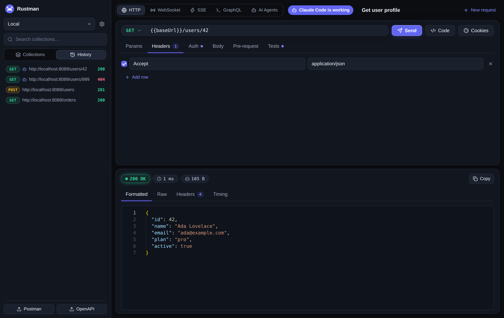

<div align="center">


# Rustman

**A fast, open-source API client for your desktop.**

Build and test APIs in a native app that keeps everything on your machine. No account, no cloud, no sign-in. Let your AI agent drive it, and automate the same collections from the terminal.

[](https://github.com/frammawiliansyah/rustman/actions/workflows/ci.yml)
[](https://github.com/frammawiliansyah/rustman/releases/latest)
[](LICENSE)


[Install](#install) · [Desktop app](#the-desktop-app) · [AI agents](#let-your-ai-agent-test-your-api) · [CLI](#for-engineers-the-command-line) · [Contributing](#contributing)

<br>



</div>

---

## Why Rustman

- **Native, not Electron.** A Rust core in a native window that uses your system's web view, with no bundled browser.
- **Local first.** Collections, environments, history and cookies live in a SQLite database on your machine. Nothing is uploaded.
- **Bring your collections.** Import Postman v2.1 collections and OpenAPI specs in one click, and export back to Postman.
- **Built for AI agents.** Connect Claude Code, Cursor or any MCP client, and watch the app fill in and send every request the agent makes.
- **Scriptable.** Test scripts in JavaScript with the familiar `pm.*` API, plus a command line runner for CI.
- **Open source.** MIT licensed.

## Install

### macOS and Linux

```sh
curl -fsSL https://github.com/frammawiliansyah/rustman/releases/latest/download/install.sh | sh
```

### Windows (PowerShell)

```powershell
irm https://github.com/frammawiliansyah/rustman/releases/latest/download/install.ps1 | iex
```

This installs the desktop app (`Rustman.app` on macOS, an application menu entry on Linux, a Start Menu shortcut on Windows) together with the `rustman` command line tool. The installers verify checksums and need no administrator rights.

| Platform | Supported |
| --- | --- |
| macOS | 11 or newer, Apple Silicon and Intel |
| Linux | x86_64 with glibc 2.35+ and OpenSSL 3: Ubuntu 22.04+, Debian 12+, Fedora 36+, RHEL and CentOS Stream 9+ |
| Windows | Windows 10 or newer, x86_64, with the WebView2 runtime (included in Windows 11 and current Windows 10) |

The Linux desktop app also needs WebKitGTK 4.1 and GTK 3:

```sh
sudo apt install libwebkit2gtk-4.1-0 libgtk-3-0 libxdo3   # Debian, Ubuntu
sudo dnf install webkit2gtk4.1 gtk3 xdotool              # Fedora, RHEL, CentOS
```

### Update

```sh
rustman update            # install the latest release (alias: rustman --update)
rustman update --check    # only check whether a newer version exists
rustman update --to v0.3.0   # install a specific version
```

`rustman update` runs the installer from the latest GitHub release, so the desktop app and the CLI are updated together, with checksum verification. Quit the desktop app first; the command stops with a message if it is still running. You can always rerun the install command instead. Rustman never checks for updates on its own.

<details>
<summary>Installer options, manual download and uninstall</summary>

Options are environment variables:

| Variable | Effect |
| --- | --- |
| `RUSTMAN_NO_DESKTOP=1` | Install the command line tool only, without the desktop app |
| `RUSTMAN_VERSION=vX.Y.Z` | Install a specific version instead of the latest |
| `RUSTMAN_UNINSTALL=1` | Remove everything the installer set up (your data in `~/.rustman` is kept) |

```sh
# Command line tool only
curl -fsSL https://github.com/frammawiliansyah/rustman/releases/latest/download/install.sh | RUSTMAN_NO_DESKTOP=1 sh

# Uninstall
curl -fsSL https://github.com/frammawiliansyah/rustman/releases/latest/download/install.sh | RUSTMAN_UNINSTALL=1 sh
```

```powershell
# Windows: set the variable first, then run the installer
$env:RUSTMAN_UNINSTALL = "1"
irm https://github.com/frammawiliansyah/rustman/releases/latest/download/install.ps1 | iex
```

You can also download archives directly from the [releases page](https://github.com/frammawiliansyah/rustman/releases). Every release lists the install commands and a `SHA256SUMS.txt` file. macOS builds are not notarized, so after a manual download run `xattr -dr com.apple.quarantine Rustman.app`.

</details>

Prefer to build it yourself? See [Build from source](#build-from-source).

## The desktop app

Open **Rustman** from your applications menu (or run `rustman-desktop` in a terminal) and start sending requests.

**Send requests**
- GET, POST, PUT, PATCH, DELETE, HEAD and OPTIONS, with headers, query params, raw or JSON bodies, form and multipart bodies, and Bearer, Basic or API key auth
- Formatted, raw and header views of the response, with status, size and timing
- A cookie manager, and code snippets for cURL, Python, JavaScript, Go and Rust
- WebSocket and Server-Sent Events clients, and a GraphQL client with schema introspection

**Organize your work**
- Collections with folders, plus a searchable sidebar and a full request history
- Environments and `{{variables}}`, with an editor, so one collection works for local, staging and production
- Import Postman v2.1 collections and OpenAPI 3.0/3.1 specs from the sidebar

**Test your APIs**
- **Pre-request** and **Tests** tabs with a JavaScript editor, using the Postman `pm.*` API (`pm.test`, `pm.expect`, `pm.sendRequest`, `postman.setNextRequest`)
- A runner that runs a whole collection or folder with one click, including data-driven runs from CSV or JSON files
- An API documentation viewer that exports a collection as HTML or Markdown

**Connect AI agents**
- An **AI Agents** tab with setup instructions for your machine, example prompts, the list of tools and your access token, all copyable with one click

**Stays out of your way**
- Everything is stored locally in `~/.rustman/rustman.db`
- No sign-in, no telemetry, no background service

## Let your AI agent test your API

Rustman includes a [Model Context Protocol](https://modelcontextprotocol.io) server, so an AI agent (Claude Code, Claude Desktop, Cursor and any other MCP client) can test your APIs through the desktop app. **The app moves on its own while the agent works**: the request form fills in, the response appears and a history entry is added for every call, tagged with a robot icon and the agent's name, with the full request config. You see what the agent does, and you can pick up any request and continue by hand.

### Connect your agent

The quickest way is the **AI Agents** tab in the app: it shows the setup for Claude Code and for Claude Desktop or Cursor with the right path for your machine, example prompts, and your access token. The same steps, by hand:

Claude Code:

```sh
claude mcp add rustman -- rustman mcp
```

Claude Desktop, Cursor and most other clients use a JSON config:

```json
{
  "mcpServers": {
    "rustman": {
      "command": "rustman",
      "args": ["mcp"]
    }
  }
}
```

Desktop apps often do not see your shell `PATH`. If the agent cannot find `rustman`, use the full path of the command instead: `/Users/<you>/.local/bin/rustman` on macOS, `/home/<you>/.local/bin/rustman` on Linux, or `C:\Users\<you>\AppData\Local\Rustman\bin\rustman.exe` on Windows.

If the Rustman desktop app is not running, `rustman mcp` starts it for you the first time the agent uses a tool (pass `--no-launch` to disable this).

Try asking your agent: *"Using Rustman, test the login and profile endpoints of my API at http://localhost:3000 and tell me which ones fail."*

### What the agent can do

| Tool | Description |
| --- | --- |
| `send_request` | Send an HTTP request (headers, query, JSON, form or multipart body, auth, test script) and get status, headers, body, timing and test results |
| `open_request` | Show a request in the app without sending it |
| `run_collection` | Run every request of a saved collection and get a per-request summary |
| `list_collections`, `get_collection` | Browse saved collections |
| `save_request` | Save or update a request in a collection (creates the collection and folders when missing) |
| `list_environments`, `set_environment_variable` | Read environments and set variables, so `{{placeholders}}` resolve |
| `list_history`, `get_history_entry` | Inspect past requests with their full config and response |
| `import_collection` | Import a Postman v2.1 collection or an OpenAPI document |
| `generate_snippet` | Generate cURL, Python, JavaScript, Go or Rust code for a request |

Collections, environments and recent history are also exposed as MCP resources (`rustman://collections`, `rustman://environments`, `rustman://history`).

### How it works and security

The desktop app runs a small local backend. `rustman mcp` talks to it over `127.0.0.1` and the app listens for live events from the same backend. Every call to the backend needs an access token. The app creates the token on first start in `~/.rustman/agent-token` (readable only by your user), embeds it in the page it serves to its own window, and `rustman mcp` reads it from the file. Web pages in your browser cannot read it, and requests with an unexpected `Host` header are refused.

Agents act with your permissions: they can send requests to any address your machine can reach, including `localhost` and your internal network. Watch the history, and only connect agents you trust. To use a fixed token (for example in a container), set `RUSTMAN_TOKEN` for both the app and `rustman mcp`.

## For engineers: the command line

The same engine ships as a `rustman` command line tool, so the collections you build in the app also run in terminal scripts and CI pipelines. It is a Newman-style runner with a non-zero exit code when requests or assertions fail.

```sh
# Run a collection (Postman v2.1, OpenAPI or native format)
rustman run collection.json -e environment.json --expect-status 200
```

```text
Iteration 1 of 1

→ GET https://example.com/
  200 · 103 ms · 577 B

+---------------------------+--------+
| iterations                |      1 |
| total requests            |      1 |
| passed                    |      1 |
| failed                    |      0 |
...
```

More things the CLI does:

```sh
# Data-driven run with a CSV or JSON file, 5 iterations
rustman run collection.json -d data.csv -n 5

# Choose a reporter: cli (default), json, htmlextra (a visual HTML report)
rustman run collection.json --reporter htmlextra --reporter-html-path report.html

# Stop at the first failure, wait 200 ms between requests
rustman run collection.json --bail --delay 200

# Global assertions
rustman run collection.json --expect-status 200 --max-time 500

# Serve a collection as a local mock server
rustman mock collection.json --port 8080

# Generate API documentation
rustman doc collection.json --format markdown -o API.md

# Import a file into SQLite and/or export it
rustman import openapi.yaml --db rustman.db
rustman import collection.json --export postman -o out.json

# One-off request
rustman request GET https://example.com -H "Accept: application/json"
```

Run `rustman --help` or `rustman <command> --help` for every option.

### Use in CI

Install the CLI only and run your collection as a pipeline step. For example, with GitHub Actions:

```yaml
- name: Install rustman
  run: curl -fsSL https://github.com/frammawiliansyah/rustman/releases/latest/download/install.sh | RUSTMAN_NO_DESKTOP=1 sh
- name: Run API tests
  run: ~/.local/bin/rustman run collection.json -e staging.json --reporter htmlextra
```

## Desktop app settings

The desktop app starts a local backend (Axum) that serves the UI and opens it in a native window (Tao and Wry, using WebKit on macOS and Linux and WebView2 on Windows). With `--headless`, or when no display is available, it only starts the backend, and you can open the printed URL in a browser.

```sh
rustman-desktop              # native window
rustman-desktop --headless   # backend only
```

The default port is `51730`.

| Variable | Purpose |
| --- | --- |
| `RUSTMAN_DB` | Path to the SQLite database file (default `~/.rustman/rustman.db`) |
| `RUSTMAN_DIST` | Path to the built frontend (default: next to the app, or `./frontend/dist`) |
| `RUSTMAN_PORT` | Port for the local backend |
| `RUSTMAN_TOKEN` | Access token for the backend and `rustman mcp` (default: generated in `~/.rustman/agent-token`) |

## Architecture

```
crates/
  rustman-core/      Core library: models, HTTP engine, scripting, importers, storage, mock, docs, codegen
  rustman-desktop/   The desktop app: local backend server and native window
  rustman-cli/       The `rustman` command line tool, including the MCP server
frontend/            React + TypeScript + Vite UI used by the desktop app
```

`rustman-core` is a reusable library; the desktop app and the CLI are thin layers on top of it.

## Build from source

Requirements:

- Rust (stable)
- Node.js and pnpm, for the frontend
- On Linux, the GTK and WebKitGTK development packages, for example `libwebkit2gtk-4.1-dev libgtk-3-dev libxdo-dev` on Debian and Ubuntu

```sh
git clone https://github.com/frammawiliansyah/rustman.git
cd rustman

(cd frontend && pnpm install && pnpm build)
cargo build --release

./target/release/rustman-desktop
./target/release/rustman --help
```

Run the tests with `cargo test --workspace`. For frontend development, start the backend (`cargo run -p rustman-desktop -- --headless`) and run `pnpm dev` inside `frontend/`. The dev server proxies `/api` to the backend and adds the access token for you.

## Project status

Rustman is under active development and is pre-1.0, so the app, the CLI and the core APIs may change between releases. Releases follow [semantic versioning](https://semver.org/) and are listed in the [changelog](CHANGELOG.md). Bug reports and feedback are welcome through [issues](https://github.com/frammawiliansyah/rustman/issues).

## Contributing

Contributions are welcome. Read [CONTRIBUTING.md](CONTRIBUTING.md) to get started. To report a security problem privately, see [SECURITY.md](SECURITY.md).

## License

Released under the [MIT License](LICENSE).

Rustman is an independent project and is not affiliated with or endorsed by Postman, Inc. Postman is a trademark of its respective owner.
